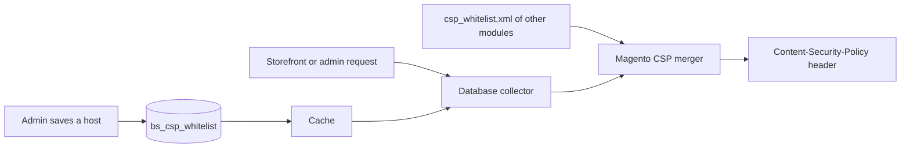
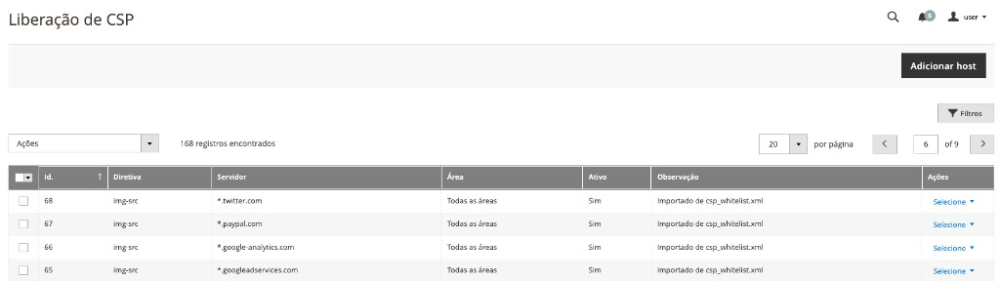

# BS_MagentoCsp

[](https://github.com/brunasebold/bs-magento-csp/actions/workflows/ci.yml)

Manage Content Security Policy hosts from the Magento admin. The store sends them on the CSP header without a deploy and without editing `csp_whitelist.xml`.

## What it does

Magento keeps extra CSP hosts in `csp_whitelist.xml`. Adding a payment, analytics or font host then takes a code change and a deploy.

`BS_MagentoCsp` stores those hosts in `bs_csp_whitelist` and plugs a collector into `Magento\Csp\Model\CompositePolicyCollector`. On each response the collector appends the active hosts for that area. Magento merges them into the directive it already built, so hosts declared by other modules stay in place.



An inactive host stays in the grid and is left out of the header. The same directive, host and area cannot be stored twice.

## Requirements

- Magento Open Source or Adobe Commerce 2.4.4 or newer
- PHP 8.1 or newer
- `Magento_Csp`, `Magento_Backend`, `Magento_Ui` and `Magento_PageCache`

## Install

Copy this directory to `app/code/BS/MagentoCsp`. To install it with Composer from the Git repository:

```bash
composer config repositories.bs-magento-csp vcs https://github.com/brunasebold/bs-magento-csp.git
composer require bs/module-magento-csp
```

Then enable it:

```bash
bin/magento module:enable BS_MagentoCsp
bin/magento setup:upgrade
bin/magento cache:flush
```

In production mode, run `bin/magento setup:di:compile` after enabling the module.

The module ships with an empty whitelist.

## Admin

**Stores > CSP Whitelist** (`Lojas > Liberação de CSP` with `pt_BR`).



The permission is **CSP Whitelist**, under **Stores**.

| Field | What to enter |
| --- | --- |
| Directive | The fetch directive from the browser error, such as `connect-src` or `script-src` |
| Host | `*.example.com`, `cdn.example.com`, `localhost` or `https://cdn.example.com` |
| Area | All areas, storefront or admin |
| Note | Optional, up to 255 characters |

A pasted URL keeps its scheme and host. The path, query and fragment are discarded, so `https://cdn.example.com/app.js?v=1` is stored as `https://cdn.example.com`. `http://` stays `http://`. The port, when present, must be from 1 to 65535.

These are not hosts and are rejected: `'self'`, `*`, `data:`, `blob:`, `'unsafe-inline'` and `'unsafe-eval'`. A wildcard is only allowed on the leftmost label (`*.cdn.example.com`).

A host saved for the storefront is sent on the storefront. A host saved for the admin is sent in the admin. **All areas** sends the host on both. Cron, web API and any other area code receive only the global hosts.

## Cache

The host list for an area is cached for 24 hours under the tag `bs_csp_whitelist`. Saving or deleting a host cleans that tag and invalidates Magento's full page cache, because a cached page can still be serving the previous CSP header.

When Varnish is the full page cache, the purge follows Magento's page-cache invalidation. Until that purge finishes, Varnish can keep the previous header. The admin message says to refresh the full page cache for that reason.

If the table is missing or the database read fails, the page is still sent. The extra hosts are omitted and the failure is written to the Magento log.

## What it does not change

- Report-only or restrict mode. That stays in **Stores > Configuration > Security > Content Security Policy**.
- `'self'`, inline scripts, `eval`, nonces and hashes.
- A directive Magento already set to `'none'`. The core merger keeps `'none'`, so a host added here does not open that directive.
- Hosts declared in `csp_whitelist.xml` by this module or any other. This package does not ship a `csp_whitelist.xml`.

The directives in the admin are the fetch directives `Magento_Csp` supports on Magento 2.4: `default-src`, `child-src`, `connect-src`, `font-src`, `frame-src`, `img-src`, `manifest-src`, `media-src`, `object-src`, `script-src`, `style-src`, `base-uri`, `form-action` and `frame-ancestors`.

## Tests

The unit tests cover the host format, the stored row, which area receives which host, the admin form payload, and the hosts the collector appends to the header. They do not boot Magento, so they run without `repo.magento.com` credentials.

```bash
phpunit -c phpunit.xml.dist
phpcs
```

GitHub Actions runs both on PHP 8.1, 8.2 and 8.3.

## Author

Bruna Sebold

## License

MIT. Copyright (c) 2026 Bruna Sebold. See [LICENSE](LICENSE).
